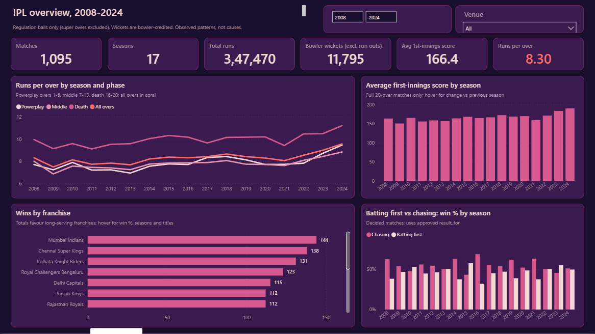
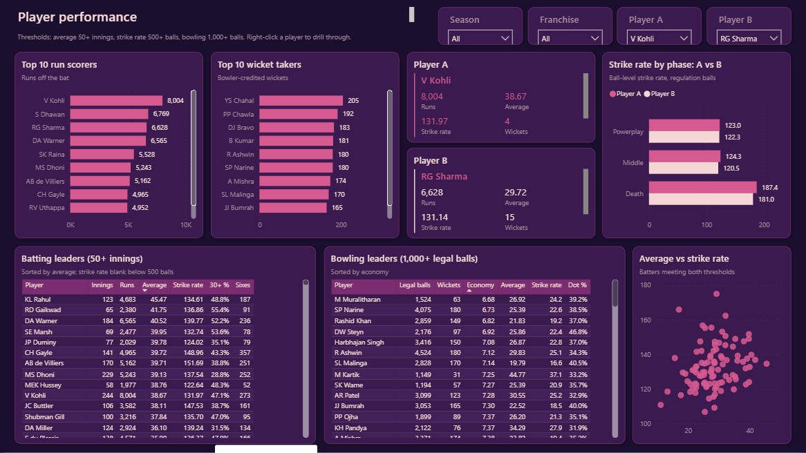
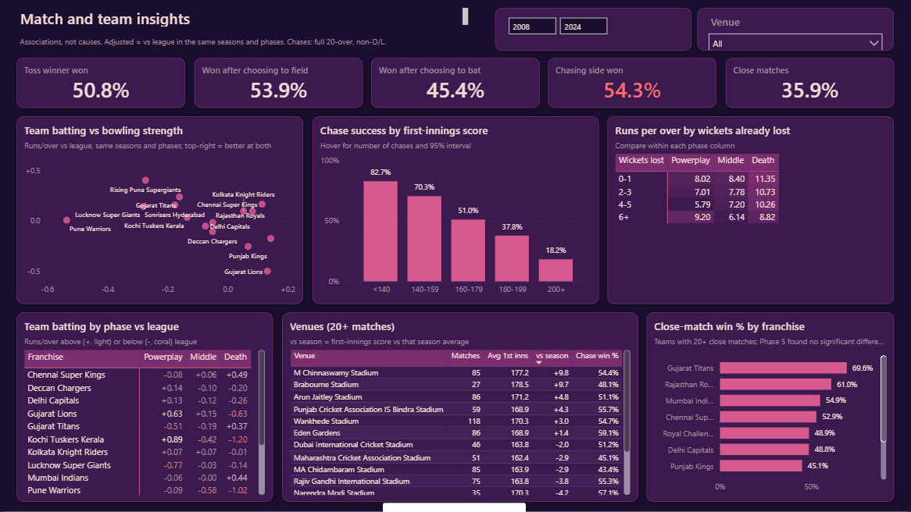

# 🏏 IPL Cricket Analytics (2008–2024)

An end-to-end data analytics project on 17 seasons of Indian Premier League cricket. It covers raw ball-by-ball data, cleaning, Python analysis, a MySQL database, advanced statistics, and an interactive Power BI dashboard. Every number is checked against at least one other source.

> **In one line:** 260,920 balls from 1,095 matches, turned into tested insights about teams, players, venues and match pressure, delivered in a 3-page Power BI dashboard.

📘 **Want the full story in simple words?** Read the **[Project Guide](documentation/PROJECT_GUIDE.md)**.

---

## 📊 The dashboard

**Page 1: IPL overview.** Shows how much is scored, how the scoring rate changed season by season and phase by phase, which franchises win most, and whether chasing beats batting first.


**Page 2: Player performance.** Shows top run scorers and wicket-takers, leader tables (only players with enough games), and a head-to-head comparison of any two players.


**Page 3: Match and team insights.** Covers toss impact, chase success by target size, scoring once wickets have fallen, team strengths by phase, venues and close matches.


---

## 🔑 Key findings

| | Finding |
|---|---|
| 📈 Scoring boom | The average first-innings score stayed between 150 and 172 from 2008 to 2022, then jumped to **183 (2023)** and **190 (2024)**. The run rate peaked at **9.56 per over in 2024**. |
| 🎯 Par score moved | The first-innings score that gives a 50/50 chance rose from **170 to 183**. The 95% interval for the rise is +1 to +26 runs, so the change is real, though the exact size is uncertain. |
| 🪙 Toss barely matters | The toss winner won **50.8%** of matches, which isn't statistically different from a coin flip. |
| 🏃 Chasing has an edge | Chasing teams won **54.3%** of decided matches. They win **83%** of chases of under 140 but only **18%** of chases of 200+. |
| 🏆 Most successful | Mumbai Indians have the most wins (144). Chennai Super Kings have the best win % among long-running teams (58.2%). |
| 🏏 Top performers | **V Kohli** has 8,004 runs and **YS Chahal** has 205 wickets. Both match the official published totals. |
| 🧊 "Clutch teams"? | No team's close-match record is statistically different from chance (p = 0.13). |

All findings are **patterns in historical data, not proof of cause**.

---

## 🛠️ Tools used

| Tool | What it was used for |
|---|---|
| **Python** (pandas, NumPy, SciPy, scikit-learn) | Data profiling, cleaning, analysis, statistics, validation |
| **Matplotlib / Seaborn** | 38 analysis charts |
| **Jupyter Notebook** | Step-by-step, readable versions of each phase |
| **MySQL 8.0** | Relational database (7 tables, 8 views) and 28 business SQL queries |
| **Power BI Desktop** | Interactive dashboard (star schema, 111 DAX measures) |
| **DAX** | Dashboard calculations (run rate, averages, win %, comparisons) |

---

## 🧭 How the project was built (6 phases)

| Phase | What happened | Checks passed |
|---|---|---|
| 1. Understand the data | Profiled 2 CSV files and documented every column and quality issue | 55 checks run (no errors; 8 issues flagged) |
| 2. Clean the data | Merged renamed teams (19 → 15) and duplicate venue names (58 → 36), and filled missing cities. No rows deleted. | 60 / 60 |
| 3. Explore (EDA) | Answered 28 questions about seasons, teams, batting, bowling and venues | 46 / 46 |
| 4. SQL database | Built a MySQL database, ran 28 queries, and matched every result with Python | 34 / 34 checks, **9,014** comparisons, 0 differences |
| 5. Advanced analytics | 32 deeper questions using confidence intervals and statistical tests. A machine-learning model was tested and rejected. | 30 / 30 |
| 6. Power BI dashboard | Generated and validated a 3-page interactive dashboard | 35 / 35 |

Details for every phase are in the **[Project Guide](documentation/PROJECT_GUIDE.md)**.

---

## 📁 Project structure

```
├── data/
│   ├── raw/            original CSVs (read-only, never changed)
│   ├── processed/      cleaned data
│   ├── reference/      team and venue name mappings
│   └── final/powerbi/  tables for the dashboard
├── python/             all scripts (01_… to 06_…)
├── notebooks/          Jupyter notebooks for phases 1, 2, 3 and 5
├── sql/                MySQL scripts (create, load, checks, analysis)
├── dashboard/          Power BI project, screenshots, dashboard docs
├── reports/            findings, charts, validation reports
└── documentation/      data dictionary, logs, guides
```

---

## ▶️ How to run it

**0. Get the data.** `deliveries.csv` (26 MB) is not stored in this repository. Download `matches.csv` and `deliveries.csv` from the Kaggle IPL ball-by-ball dataset (2008–2024) into `data/raw/`. The scripts recreate everything in `data/processed/` and `data/final/`.

**1. Install the Python libraries**
```bash
pip install pandas numpy scipy scikit-learn matplotlib seaborn mysql-connector-python nbformat nbconvert
```

**2. Run the analysis (phases 1–3 and 5)**
```bash
python python/01_data_profiling.py
python python/02a_build_reference_mappings.py
python python/02b_clean_data.py
python python/02c_validate_cleaned.py
python python/03_eda.py
python python/05_advanced_analytics.py
```

**3. MySQL (phase 4).** Follow [mysql_setup_guide.md](documentation/mysql_setup_guide.md). Set `MYSQL_USER` and `MYSQL_PASSWORD` as environment variables; passwords are never stored in files. Then run:
```bash
python python/04_load_mysql.py
python python/04b_validate_mysql.py
python python/04c_run_sql_analysis.py
python python/04d_reconcile_sql_python.py
```

**4. Power BI (phase 6)**
```bash
python python/06b_export_powerbi_model.py
python python/06c_build_pbip.py
```
Then open `dashboard/IPL_Cricket_Analytics/IPL_Cricket_Analytics.pbip` in Power BI Desktop and click **Refresh**. To get a single file, use **File → Save as → .pbix**. Full steps are in the [Power BI setup guide](dashboard/docs/power_bi_setup_guide.md).

---

## ⚠️ Limitations
- **Abandoned matches:** matches abandoned before a ball was bowled are not in the data.
- **Missing context:** there is no player role, batting position, bowling type, pitch or home-team information.
- **Fours and sixes:** counted from runs scored (4 or 6), because the data has no "boundary" flag.
- **Few recent seasons:** 2023–24 is only two seasons, so recent trends are less certain.

## 📄 Data source
Kaggle IPL ball-by-ball dataset (`matches.csv`, `deliveries.csv`), which originally comes from Cricsheet. See [data_source_and_lineage.md](documentation/data_source_and_lineage.md).
