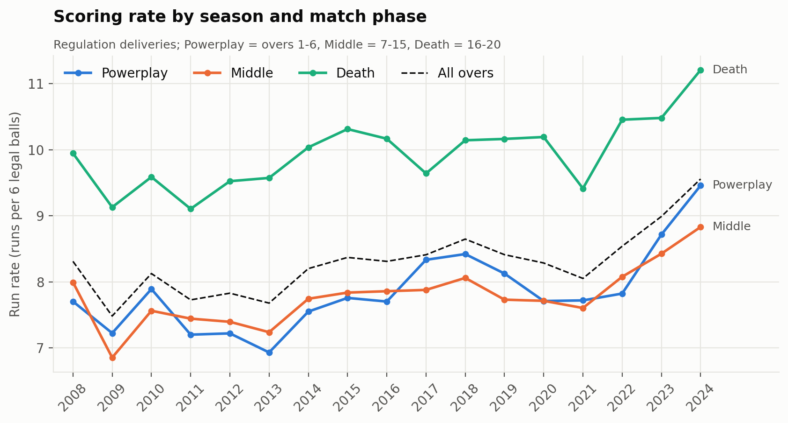
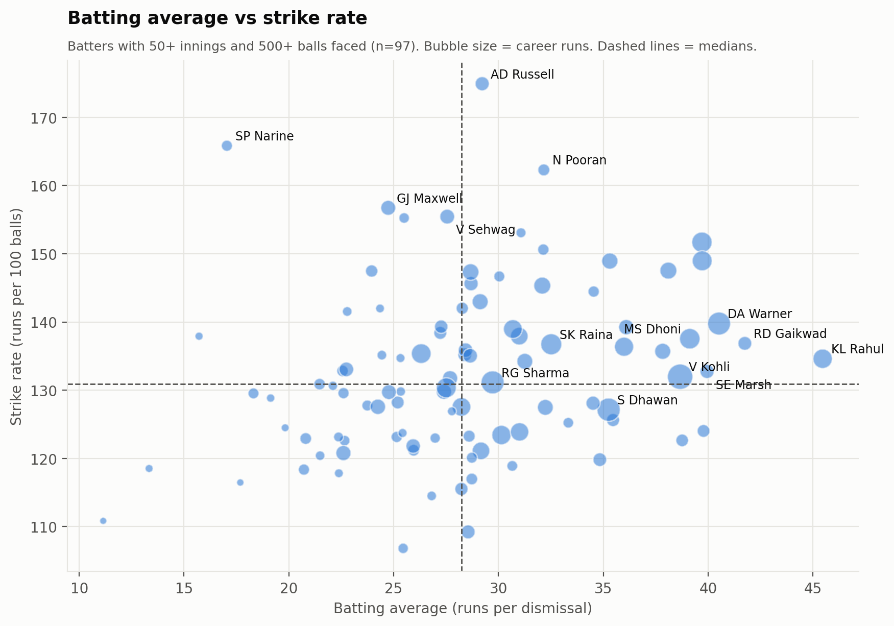
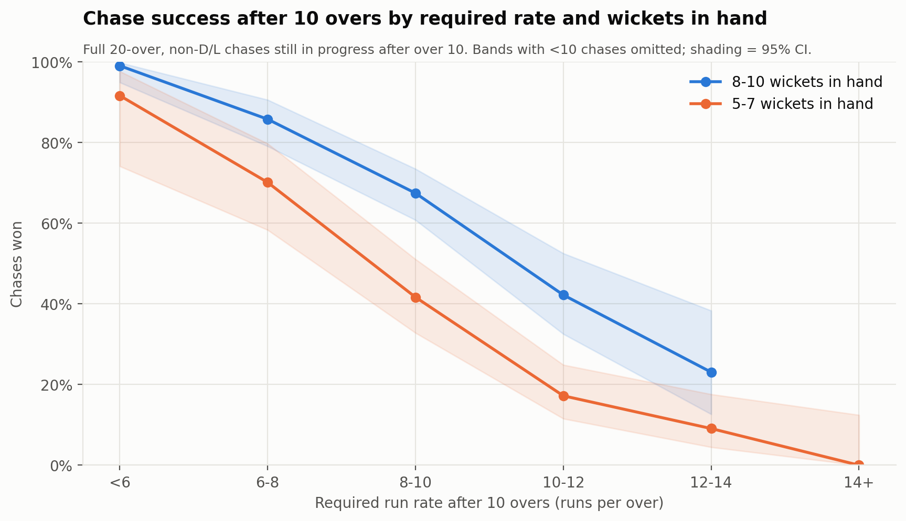
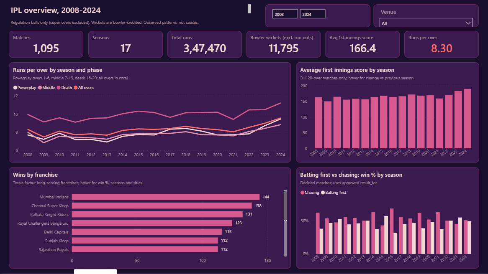
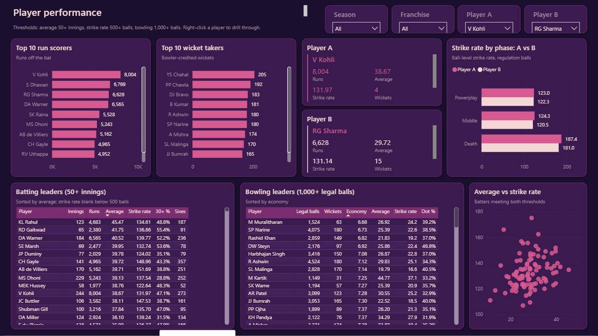
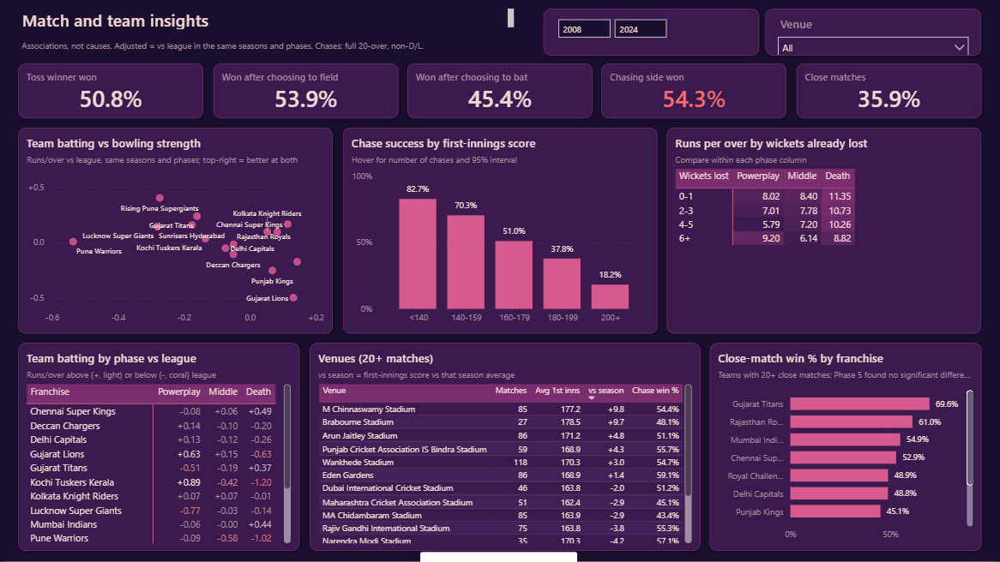

# IPL Cricket Analytics: Complete Project Guide

This guide explains **how the whole project was done, step by step, in simple language**. It's written for someone seeing the project for the first time: a recruiter, an interviewer, or a classmate.

For a quick overview, see the [README](../README.md).

---

## Contents
1. [What is this project?](#1-what-is-this-project)
2. [The data](#2-the-data)
3. [Cricket terms used in this project](#3-cricket-terms-used-in-this-project)
4. [Tools used and why](#4-tools-used-and-why)
5. [Phase 1: Understanding the data](#5-phase-1-understanding-the-data)
6. [Phase 2: Cleaning the data](#6-phase-2-cleaning-the-data)
7. [Phase 3: Exploring the data (EDA)](#7-phase-3-exploring-the-data-eda)
8. [Phase 4: MySQL database and SQL analysis](#8-phase-4-mysql-database-and-sql-analysis)
9. [Phase 5: Advanced analytics](#9-phase-5-advanced-analytics)
10. [Phase 6: The Power BI dashboard](#10-phase-6-the-power-bi-dashboard)
11. [How to use the dashboard](#11-how-to-use-the-dashboard)
12. [How we made sure the numbers are right](#12-how-we-made-sure-the-numbers-are-right)
13. [Important decisions and why](#13-important-decisions-and-why)
14. [Limitations](#14-limitations)
15. [How to run everything](#15-how-to-run-everything)
16. [Where to find everything](#16-where-to-find-everything)

---

## 1. What is this project?

The IPL (Indian Premier League) is a professional T20 cricket league. Each team bats for up to 20 overs (120 legal balls).

**Goal:** take raw IPL data and answer real questions such as:
- Is scoring getting higher?
- Does winning the toss help?
- Is chasing easier than batting first?
- Who are the best batters and bowlers, judged fairly?
- How does match pressure change the result?

Then put the answers in an **interactive dashboard** that anyone can explore.

**The project's rule:** *never trust a number you haven't checked.* Every important result was calculated in two or more ways, for example in both Python and SQL, and compared.

---

## 2. The data

We started with two CSV files downloaded from Kaggle. The data originally comes from Cricsheet.

| File | One row is… | Rows | Columns |
|---|---|---|---|
| `matches.csv` | one match | 1,095 | 20 |
| `deliveries.csv` | one ball bowled | 260,920 | 17 |

- The two files connect through the match ID: `matches.id = deliveries.match_id`.
- They cover **17 seasons, from 2008 to 2024**.

The original files are kept untouched in `data/raw/` and are read-only. Their fingerprints (SHA-256 hashes) are checked every time a script runs, so we would know if they ever changed.

---

## 3. Cricket terms used in this project

| Term | Simple meaning |
|---|---|
| **Over** | 6 legal balls bowled by one bowler |
| **Legal ball** | Any ball that isn't a wide or a no-ball. Wides and no-balls must be bowled again. |
| **Extras** | Runs not scored off the bat: wides, no-balls, byes, leg-byes, penalties |
| **Run rate** | Runs per over = runs × 6 ÷ legal balls |
| **Batting average** | Runs ÷ number of times out. Shows how hard a batter is to get out. |
| **Strike rate (batting)** | Runs per 100 balls faced. Shows how fast a batter scores. |
| **Economy (bowling)** | Runs conceded per over. Lower is better. |
| **Bowling average** | Runs conceded per wicket. Lower is better. |
| **Bowling strike rate** | Balls per wicket. Lower means the bowler takes wickets more often. |
| **Bowler wicket** | A wicket credited to the bowler: bowled, caught, lbw, stumped, hit wicket. **Run-outs are not bowler wickets.** |
| **Retired hurt** | A batter leaves injured. This is **not** "out". |
| **Powerplay / Middle / Death** | Overs 1–6, overs 7–15 and overs 16–20 |
| **Super over** | A one-over tie-breaker. Kept **separate** from normal statistics. |
| **D/L method** | A rule that changes the target when rain shortens a match |
| **Chasing** | Batting second, trying to reach the target |

---

## 4. Tools used and why

| Tool | Why we used it |
|---|---|
| **Python + pandas** | Reading, cleaning and analysing 260k rows quickly and reproducibly |
| **NumPy / SciPy** | Calculations and statistical tests (confidence intervals, correlations) |
| **scikit-learn** | Testing whether a prediction model was worth using (it wasn't published; see Phase 5) |
| **Matplotlib / Seaborn** | Charts for the reports |
| **Jupyter Notebook** | Readable walkthroughs of each phase with code and results together |
| **MySQL 8.0** | A proper relational database, and checking Python results with SQL |
| **Power BI + DAX** | The interactive dashboard and its calculations |
| **Git-friendly files** | The dashboard is saved as a Power BI *Project* (text files), so every change can be tracked |

---

## 5. Phase 1: Understanding the data

**Goal:** know the data before changing anything.

**What we did (in simple steps):**
1. Loaded both files and counted rows, columns, data types and missing values.
2. Checked that every ball belongs to a real match, and every match has balls.
3. Rebuilt match results from the ball data to see whether they agreed. They did: every target and winner matched.
4. Wrote a **data dictionary** explaining every column.

**What we found (55 checks):**
- The data is very clean structurally: no duplicates and no broken links.
- **8 issues needed fixing or care:**
  - Team names changed over time (Delhi Daredevils → Delhi Capitals).
  - The same ground had several spellings.
  - 51 matches had no city.
  - Three season labels were odd (`2007/08` actually means 2008).
  - The `team1` column is **not** the team batting first.
  - "Retired hurt" is marked as a wicket.
  - 29 overs had 7 legal balls (real umpire miscounts).

📄 Files: `python/01_data_profiling.py`, `notebooks/01_data_profiling.ipynb`, `documentation/data_dictionary.md`.

---

## 6. Phase 2: Cleaning the data

**Goal:** fix the issues *without losing or inventing any data*.

**What we did:**

| Problem | Fix | Result |
|---|---|---|
| Teams renamed over the years | Merged only true renames (e.g. Kings XI Punjab → Punjab Kings). Deccan Chargers and Sunrisers Hyderabad stay separate, because they are different franchises. | 19 names → **15 franchises** |
| Same ground, different spellings | Built a mapping table. Renamed grounds (e.g. Feroz Shah Kotla → Arun Jaitley Stadium) were **checked against news sources** before merging. | 58 names → **36 grounds** |
| Missing cities | Filled using the same ground's city from other matches | 51 filled and flagged |
| Odd season labels | Took the season from the match date | 17 clean seasons |
| Super overs, retired hurt, 7-ball overs | **Kept**, with a flag column on each so analysis can include or exclude them | Nothing deleted |

**New helpful columns:** legal ball, runs the bowler is charged for, bowler wicket, batter out, match phase, the team batting first, and the result from the batting-first team's point of view (`result_for`).

**Something we discovered:** 6 rain-affected matches were "won by runs" by the *chasing* team. This looked wrong but is correct under the D/L rule (the chase was ahead of the revised target when rain stopped play). We kept it and documented it.

✅ **60 out of 60 checks passed**, comparing before and after cleaning (same rows, same totals).

📄 Files: `python/02a…02c`, `notebooks/02_data_cleaning.ipynb`, `documentation/transformation_log.md`.

---

## 7. Phase 3: Exploring the data (EDA)

**Goal:** answer 28 business and cricket questions with clear charts.

**Examples of what we learned:**
- **Scoring is rising fast.** The average first-innings score was 150–172 in every season from 2008 to 2022, then rose to 183 in 2023 and 190 in 2024.

  

- **The toss hardly matters.** The toss winner won 50.8% of matches, which isn't statistically different from 50%.
- **Chasing is slightly better.** Chasing teams win 54.3% of decided matches.
- **Kohli leads the run scorers** with 8,004 runs, which matches the official figure. **Chahal leads the wicket-takers** with 205.

  

**Fair comparisons:**
- **Minimum samples:** players are ranked only with enough games (50+ innings for averages, 500+ balls for strike rate, 1,000+ balls for bowling).
- **Era adjustment:** for teams and venues, we compared against the league average **in the same seasons**, so teams that only played in high-scoring 2023–24 don't look unfairly strong.

**Honesty check:** six of my own first-draft sentences said more than the numbers supported, for example calling a correlation "weak" when it was moderate. They were rewritten from the computed values.

✅ **46 / 46 checks passed.**
📄 Files: `python/03_eda.py`, `notebooks/03_exploratory_data_analysis.ipynb`, `reports/eda_report.md`, 18 charts in `reports/charts/`.

---

## 8. Phase 4: MySQL database and SQL analysis

**Goal:** store the data in a real database and prove the SQL answers match Python.

**Database design (simple version):**
- **Lookup tables:** `team`, `venue` and `player`. Each name is stored only once.
- **Main tables:** `matches` (1,095 rows) and `deliveries` (260,920 rows).
- **Links:** 18 foreign keys. For example, every ball must belong to a real match and a real player.
- **Saved queries:** 8 **views** hold the cricket rules (for example "exclude super overs") so every query uses the same definitions.

**How it was loaded safely:**
- All data loads in **one transaction**, and totals are checked *before* saving. If anything doesn't match, nothing is saved.
- Running it twice gives the same result, with no duplicates.
- Passwords come from environment variables and are never written in files.

**What we ran:** 28 business questions in SQL (season trends, team wins, top players, toss, venues, margins), using joins, CTEs, window functions and CASE statements.

**The big check:** every season, team, **677 batters, 530 bowlers** and the venues were compared between SQL and Python:
**9,014 comparisons and 0 differences.** The tiny gaps were around 0.00000000000001, from how computers store decimals.

✅ **34 / 34 database checks passed.**
📄 Files: `sql/01…06`, `python/04_…`, `reports/sql_business_analysis_report.md`, `documentation/database_schema.md`.

---

## 9. Phase 5: Advanced analytics

**Goal:** go deeper (32 questions), using proper statistics where needed.

**New techniques, in simple terms:**
- **Confidence intervals:** a range showing how sure we are. For example, "83% of short chases succeed (we're 95% sure the true value is between 77% and 87%)".
- **Season-and-phase adjustment:** compare a player or team with the league **in the same seasons and same overs**. Death overs are always expensive, and 2024 was high-scoring for everyone.
- **Statistical tests:** used only when we claim a difference is real.

**Highlights:**

| Question | Answer |
|---|---|
| How does the target size affect a chase? | Chases of under 140 succeed 83% of the time; chases of 200+ only 18% |
| After 10 overs, needing 8–10 an over? | Won 67% of the time with 8–10 wickets left, but only 42% with 5–7 wickets left |
| Are some teams "clutch" in close games? | No evidence; the differences look like chance |
| Does the venue change chasing success? | Not significantly (p = 0.61) |
| What's a "par" first-innings score? | 170 in 2008–22, **183** in 2023–24 |



**Machine learning: tested, then rejected.**
- **Win-before-the-match prediction:** rejected. The available signals (toss, venue) are close to a coin flip.
- **"Chance of winning during a chase" model:** built and tested on unseen seasons. It ranked chases well, but its probabilities were **off by up to 8.5 percentage points in 2024**. Because it wasn't reliable enough, it was **not** put on the dashboard.

✅ **30 / 30 checks passed**, including 4 cross-checks against MySQL.
📄 Files: `python/05_advanced_analytics.py`, `notebooks/05_advanced_cricket_analytics.ipynb`, `reports/advanced_analytics_report.md`, 20 charts in `reports/charts/phase5/`.

---

## 10. Phase 6: The Power BI dashboard

**Goal:** a professional, interactive dashboard built only on validated data.

**Data model (star schema, explained simply):**
- **4 "fact" tables** hold the events:

  | Table | One row is… |
  |---|---|
  | `FactDelivery` | one ball |
  | `FactBattingInnings` | one player's innings |
  | `FactTeamMatch` | one team in one match |
  | `FactMatch` | one match |

- **5 "dimension" tables** hold the things you filter by: Season, Team, Venue, Player and Phase.
- **Relationships:** each dimension filters the facts in one direction only. This keeps results predictable and avoids double counting.
- **Batting vs bowling:** a player or team can bat *or* bowl. The model uses an "active" link for batting and an "inactive" link for bowling, and bowling measures switch to the bowling link.

**Calculations:** 111 DAX measures, all following the same rules as Python and SQL (legal balls for run rate, bowler-only wickets, no super overs, and so on).

**Design:**
- Built with **your six-colour palette**: deep purple background, plum cards, pink as the main colour, light pink-white text, and coral for one standout number per page.
- Every colour was **checked for readability**. For example, the darker purple wasn't readable enough for chart bars, so it's used for borders instead.

**How it was built:**
- The dashboard is **generated by a Python script** (`06c_build_pbip.py`) as a Power BI *Project*, so it can be rebuilt any time.
- Power BI Desktop opened and refreshed it, and we **queried its engine directly** to check every number.

✅ **35 / 35 checks passed**: KPIs, every player, team, season and venue, rankings, filters and relationships.

---

## 11. How to use the dashboard

Open `dashboard/IPL_Cricket_Analytics/IPL_Cricket_Analytics.pbip`, or the saved `.pbix`, in Power BI Desktop. Click **Refresh** if the visuals are empty.

### Page 1: IPL overview


**Filters (top right):**
- **Season:** drag the range slider to choose seasons.
- **Venue:** pick a ground.

**What each part shows:**
- **KPI cards:** matches, seasons, total runs, bowler wickets, average first-innings score, runs per over.
- **Runs per over by season and phase:** lines for Powerplay, Middle, Death and all overs.
- **Average first-innings score by season:** hover over a bar to see the change from the previous season.
- **Wins by franchise:** hover to see win %, seasons played and titles.
- **Batting first vs chasing:** the win % of each approach, season by season.

### Page 2: Player performance


**Filters:** Season, Franchise, **Player A** and **Player B**. Pick any two players to compare.

**What each part shows:**
- **Top 10 run scorers and wicket-takers.** These update with your filters.
- **Player A and B cards:** runs, average, strike rate, wickets and economy, side by side.
- **Strike rate by phase:** how each player scores in the Powerplay, Middle and Death overs.
- **Leader tables:** only players with enough games. A blank cell means "not enough data".
- **Average vs strike rate:** who is both consistent and fast.

**Drill-through:** right-click any player name and choose **Drill through → Player detail** to see that player's season-by-season record.

**Franchise filter:**

| Measure type | The franchise means… |
|---|---|
| Batting numbers | the team they batted for |
| Bowling numbers | the team they bowled for |

### Page 3: Match and team insights


**Filters:** Season and Venue.

**What each part shows:**
- **Toss cards:** how often the toss winner won, and whether choosing to field or bat did better.
- **Team strength scatter:** batting (left to right) vs bowling (bottom to top), both compared with the league. Top-right means good at both.
- **Chase success by target:** hover to see the number of chases and the 95% range.
- **Runs per over by wickets lost:** how scoring slows as wickets fall, within each phase.
- **Team phase matrix:** light numbers mean better than the league; coral means worse.
- **Venues table and close-match chart:** only grounds and teams with 20 or more matches.

**Tip:** hover over any bar or point to see extra details.

---

## 12. How we made sure the numbers are right

| Phase | Checks | Result |
|---|---|---|
| 1. Profiling | 55 | 37 OK, 10 informational, 8 issues found (then fixed in Phase 2) |
| 2. Cleaning | 60 | 60 passed |
| 3. EDA | 46 | 46 passed |
| 4. SQL | 34, plus 9,014 SQL vs Python comparisons | All passed, 0 differences |
| 5. Advanced | 30 | 30 passed |
| 6. Dashboard | 13 data checks + 35 dashboard checks | All passed |

**Checked against the outside world:**
- Kohli's 8,004 runs matches the published figure.
- The list of IPL champions from 2008 to 2024 matches the public record.

**Mistakes caught and fixed along the way:**
- A broken dashboard formula after a column rename.
- Wording that overstated results.
- A validation check that was too strict.

Each one is recorded in `documentation/project_log.md`.

---

## 13. Important decisions and why

| Decision | Why |
|---|---|
| Never delete unusual records (super overs, 7-ball overs, retired hurt) | They're real. Flagging them keeps the data honest. |
| Merge only true team renames | Deccan Chargers and Sunrisers Hyderabad are different franchises. Merging them would be wrong. |
| Verify renamed grounds against news sources | Don't merge on guesswork. |
| Use `result_for`, not "won by runs / wickets" | Under rain rules, a chasing team can win "by runs". |
| Minimum-sample thresholds for rankings | A player with 5 innings and a 60 average isn't really better than one with 200 innings. |
| Compare against the league in the same seasons | Scoring changed a lot over 17 years. |
| Don't publish the prediction model | Its probabilities weren't accurate enough on recent seasons. |
| Use CSV extracts for Power BI instead of a live MySQL connection | No passwords stored in the report, and identical numbers (checked against MySQL). |

---

## 14. Limitations

- **Missing matches:** matches washed out before a ball was bowled aren't in the data.
- **Missing context:** there's no player role, batting position, bowling type, pitch condition or "home team" column.
- **Fours and sixes:** counted from runs (4 or 6), because there's no boundary flag.
- **Recent seasons:** 2023–24 is only two seasons, so recent conclusions are less certain.
- **Observational data:** results show what happened together, not what *caused* it.

---

## 15. How to run everything

```bash
# Python libraries
pip install pandas numpy scipy scikit-learn matplotlib seaborn mysql-connector-python nbformat nbconvert pillow

# Phases 1-3 and 5
python python/01_data_profiling.py
python python/02a_build_reference_mappings.py
python python/02b_clean_data.py
python python/02c_validate_cleaned.py
python python/03_eda.py
python python/05_advanced_analytics.py

# Phase 4 (MySQL; set MYSQL_USER and MYSQL_PASSWORD first, see mysql_setup_guide.md)
python python/04_load_mysql.py
python python/04b_validate_mysql.py
python python/04c_run_sql_analysis.py
python python/04d_reconcile_sql_python.py

# Phase 6 (Power BI)
python python/06b_export_powerbi_model.py
python python/06c_build_pbip.py
```

Then open the `.pbip` in Power BI Desktop and click **Refresh**. To save a single file, use **File → Save as → .pbix**.

---

## 16. Where to find everything

| You want… | Look here |
|---|---|
| A quick overview | `README.md` |
| What each column means | `documentation/data_dictionary.md` |
| Every cleaning step | `documentation/transformation_log.md` |
| A diary of the whole project | `documentation/project_log.md` |
| EDA findings | `reports/eda_report.md` |
| SQL queries and results | `reports/sql_business_analysis_report.md` |
| Advanced findings | `reports/advanced_analytics_report.md` |
| Database design | `documentation/database_schema.md`, `database_relationships.md` |
| Dashboard measures and model | `dashboard/docs/power_bi_dax_measures.md`, `power_bi_data_model.md` |
| Dashboard setup | `dashboard/docs/power_bi_setup_guide.md` |
| Validation reports | `reports/validation/`, `reports/*validation*`, `reports/powerbi/` |
