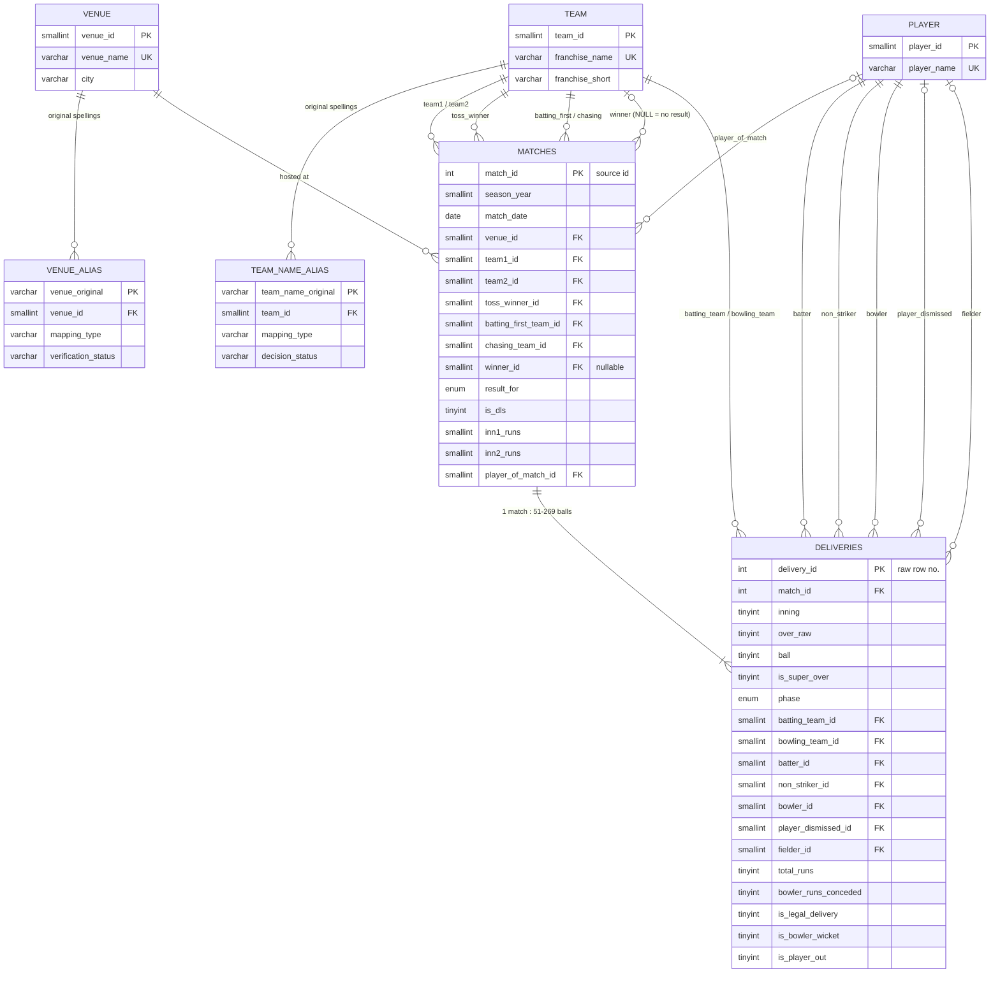

# Database Relationships & ER Diagram — `ipl_cricket_analytics`

The diagram below is Mermaid; GitHub and VS Code render it automatically. Column lists are abbreviated to keys and the most important attributes. The full definitions are in [database_schema.md](database_schema.md) and `sql/02_create_tables.sql`.

## Relationship rules

| Relationship | Cardinality | Enforced by |
|---|---|---|
| `matches` → `deliveries` | 1 : many. Every match has 51–269 deliveries; there are no orphans in either direction. | `fk_d_match`; checks Q07/Q08 |
| `team` → `matches` (6 roles) | 1 : many per role | 6 FKs. `winner_id` is NULL only for no-results (`ck_m_winner_nr`). |
| `team` → `deliveries` (batting, bowling) | 1 : many | 2 FKs; `ck_d_teams` (batting ≠ bowling) |
| `player` → `deliveries` (5 roles) | 1 : many per role | 5 FKs. A player can be batter, non-striker, bowler, dismissed player or fielder, so one `player` table serves every role. |
| `venue` → `matches` | 1 : many | `fk_m_venue` |
| `team`/`venue` → alias tables | 1 : many | Keeps all 19 original team names and 58 original venue strings |

**Batting order** comes from `batting_first_team_id` / `chasing_team_id`, which Phase 2 derived from innings-1 deliveries. `team1`/`team2` are kept only for lineage, because `team1` bats first in just 72.6% of matches.

**Natural key.** Besides the surrogate primary key `delivery_id`, `deliveries` has a UNIQUE `(match_id, inning, over_raw, ball)` constraint, so the same ball can never be loaded twice.
